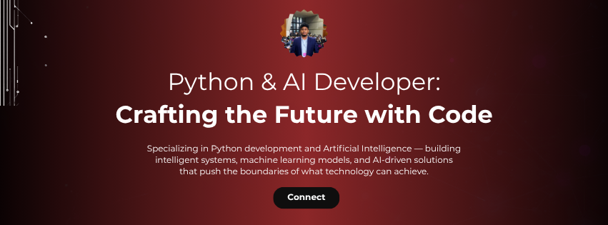

<!-- Banner -->

  

<h1 align="center">Hi 👋, I'm Nishan Das</h1>

<h3 align="center">
Python Developer • AI Engineer • Machine Learning Enthusiast
</h3>

Building intelligent systems that solve real-world problems with Python, Artificial Intelligence, and Computer Vision.

---

## 🚀 About Me

🎓 Computer Science & Engineering Student at **Dhaka University of Engineering & Technology (DUET), Gazipur**

💻 Passionate about developing intelligent software using modern AI technologies.

🤖 Exploring:

- Artificial Intelligence
- Machine Learning
- Deep Learning
- Computer Vision
- Backend Development
- Django
- REST APIs

🏆 Active Hackathon Participant & Competitive Programmer

🌱 Constantly learning new technologies and building impactful projects.

---

# 🛠 Tech Stack

### 💻 Languages

---

### 🤖 AI / Machine Learning

---

### 🌐 Backend

---

### 💻 Frontend

---

### ⚙️ Tools

---

# 🚀 Current Focus

- 🤖 AI & Machine Learning Projects
- 🚗 Computer Vision for Intelligent Transportation
- 🧠 Deep Learning Models
- 🌐 Python Backend Development
- 📊 Data Analysis & Automation

---

# 🏆 Recent Highlights

🥈 **1st Runner-Up** — Project Showcasing, AI Hackathon (DUET CSE Carnival 2026)

🌟 **Rising Team Award**

🚗 Developing **RoadVision BD** — AI-powered Vehicle Detection & Classification System for Bangladesh Traffic

---

# 📊 GitHub Stats

---

# 📫 Connect With Me

---

### "Crafting the Future with Code."

Building AI-powered solutions that transform ideas into intelligent applications.

⭐ Thanks for visiting my profile!

